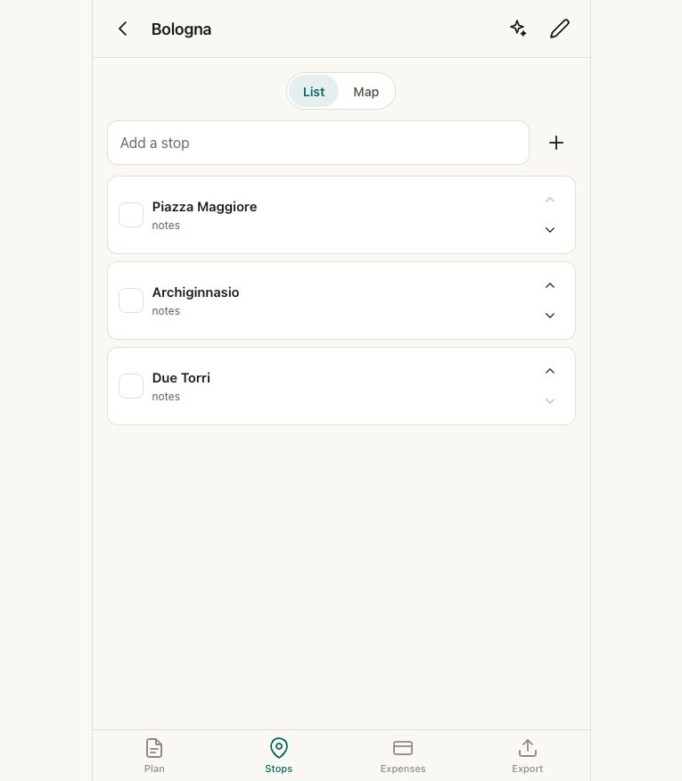
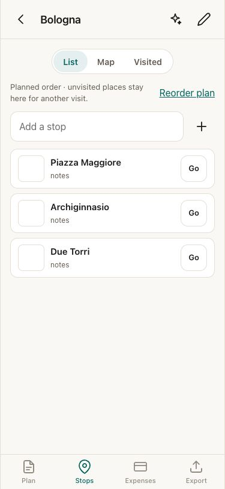
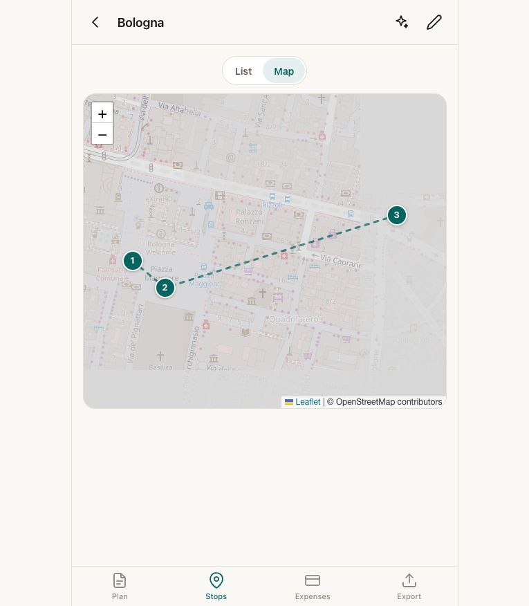
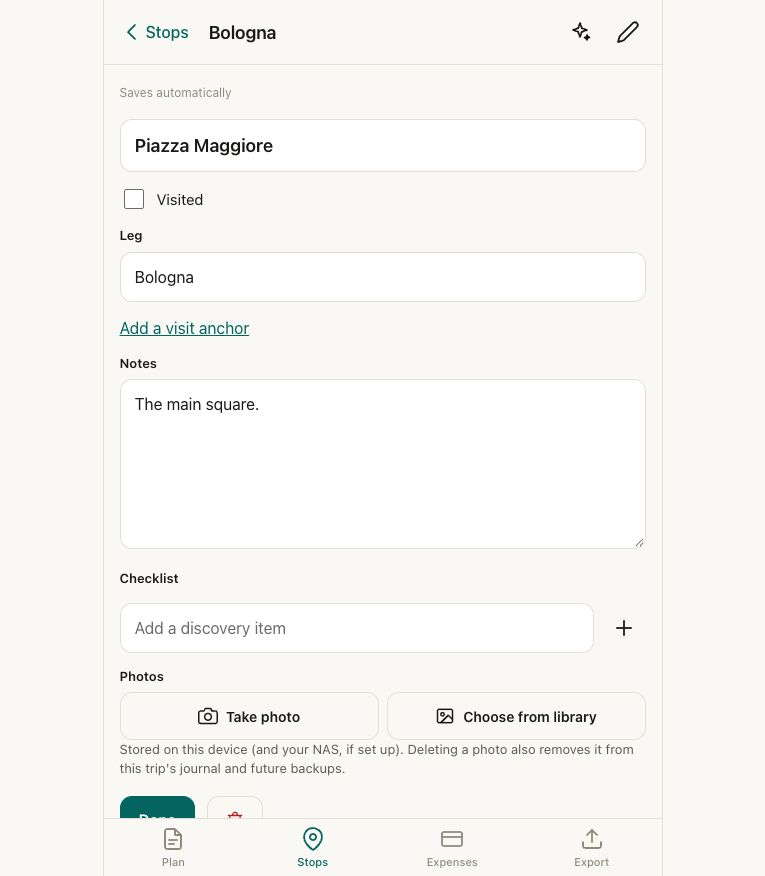
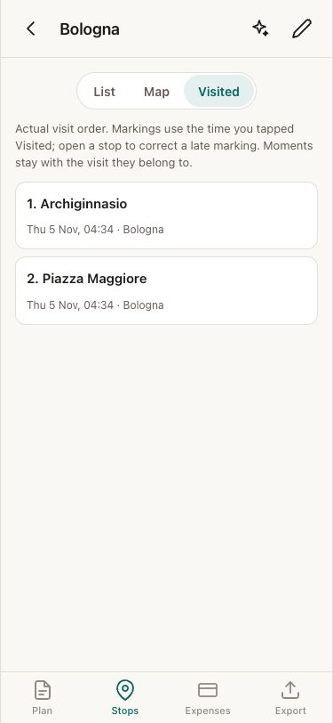
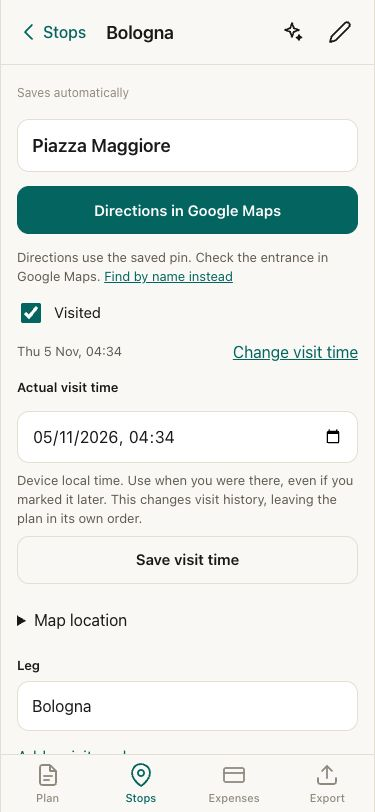

# Travel workflow review

Reviewed from `main` at `9a5f506`. Synthetic trip only. This is a product and
engineering assessment of the reported workflow, not evidence from a field trial.

## Decision

Use the trip's existing Stops as the launch point for Google Maps. Keep the
planned route and actual visit history separate. There is no reason to copy
selected places into Favourites, remove them afterwards or renumber their names.

Keep discovery in Google Maps and other sources. A large collection of possible
places has little demonstrated value here. Extract the selected itinerary once;
unvisited stops stay with that trip for future reference, without another list
to maintain. No saved-place library, sync with Google, tracking, geocoding or
routing engine was added. There are no new dependencies or stored fields.

## Observed flow and changes

1. **Extract and prepare: usable, with a missing handoff.** The existing extractor
   already carries notes and coordinates into Stops. The original list had no
   navigation action, while reorder controls occupied every row. Now Go opens
   directions to the saved pin; Find searches by name and city when no pin exists.
   Reordering sits behind Reorder plan. Visit targets are 44px; long names wrap.

   
   

2. **Navigate: spatial overview retained, destination made explicit.** The
   existing map already showed numbered stops. Its connecting lines were easy
   to mistake for walking routes. It now explains that numbers and lines show
   the plan, and each stop popup offers Google Maps directions. Stop details
   also offer a name search and coordinate correction. A saved pin is not a
   verified entrance. Google owns route choice and navigation.

   

3. **Remember and correct: the main correctness gap.** `visitedAt` was recorded
   but `visitTimeline` still ordered stops by the plan. The timestamp was not
   editable in Stop details. Visited and the trip pack now follow visit times.
   Linked Moments remain attached to their visit; loose Moments follow their
   own time. Untimed historical visits remain explicitly unknown, after timed
   visits in planned order. Correcting a timestamp uses the leg's time zone,
   or the existing historical/device fallback. It never changes planned order.

   
   
   

4. **Export and retain: corrected, with old data preserved.** The trip pack uses
   the same timeline as Visited. Unvisited places remain in its Stops section,
   separate from visit history. Photos and their references are unchanged.
   Corrected timestamps and pins use the existing NAS merge and ZIP restore.

## Confirmed audit hypotheses

- An open booking sheet kept its typed amount but used live payment data while
  saving. Its existing warning only covered a newly arrived payment. It now
  snapshots the opening expense, warns for changed/deleted payments, and compares
  the snapshot inside the booking transaction before writing either booking or
  payment. Reference-only saves still preserve a newly arrived payment's money.
- Taxi, Uber and cab matched the automatic no-booking rule. They now require a
  reference/payment or an explicit Pay on the day choice with journey details.
  Walking and metro still need no booking choice.
- Flight quotes were totals for the original party but displayed without that
  basis. Their original notes are now visible. Only a quote whose recorded party
  matches can prefill a payment. Unknown bases remain readable; nothing reprices
  history or turns a quote into spending. A party change is checked at save too.

## Verification and review limits

Final local checks: 350 unit tests, 453 browser tests and the production PWA
update test passed. The browser run included current, previous and original
PHP NAS receivers. Three opt-in checks for a personal live NAS were skipped,
one per browser profile; no personal NAS was contacted. Formatting, lint,
Svelte/TypeScript checks, production build, PHP syntax and `git diff --check`
also passed.

Regression coverage includes Google Maps handoff without recording a visit,
missing/corrected pins, visits out of planned order, offline and post-trip time
correction, unknown historical times, Moments, exported Markdown, independent
note/time edits through NAS sync, ZIP restore, payment edit/deletion conflicts,
reference-only saves, and historical quotes after a party change. Stops views
also support arrow/Home/End keys and labelled panels.

Screenshots were captured in the in-app browser and inspected locally. They do
not establish full accessibility compliance. Browser tests exercise Chromium,
mobile Chromium and iPhone/WebKit. A real installed iPhone should still check
the Google Maps app handoff and return to Systema. Coordinate accuracy and
whether this replaces Favourites comfortably on a real trip need an owner trial.

The independent reviewer should scrutinise payment comparison before the first
write, the distinction between plan and history, unknown-time treatment, and
quote provenance. Noninteractive booking calls retain their existing behaviour;
the sole interactive booking form always supplies its opening payment snapshot.

## Independent review outcome

Reviewed on the branch at `bee3d30`, against the priorities above.

**Confirmed and corrected.** The reported coordinate-draft fault is real and was
reachable without a sync: `StopsTab` stays mounted across the detail, so its
initialisation guards still named the stop last opened. Reopening that stop
after its pin moved showed the old latitude and longitude, and Save map
location wrote them back over the move. The same shape sat on the name and
notes drafts, where a note arriving by sync or restore while the detail was
closed would be typed back over on the next keystroke. Both guards now clear
with the route, not with the record — a stop briefly absent while the live
query reloads must not wipe what is being typed. Covered by a browser test
that fails without the fix.

A second fault, found on the corrected branch: Visited had no empty-trip guard
where Map has one, so deleting the last place from Visited left that view
rendering with its selector gone — no Add a stop, no Extract, and the view is
remembered, so a reload did not recover it. Visited now falls through to the
list for an empty trip, exactly as Map does.

Two smaller corrections: the Go/Find link's accessible name now begins with the
word on screen (WCAG 2.5.3), and the visit-time round trip ignores seconds a
picker may add, so a valid time is never refused as a clock change.

**Examined and rejected.** The payment comparison is sound: it runs inside the
write transaction before either half of the booking is touched, and a rejection
rolls the whole thing back. It cannot be tripped by an ordinary sync, because
`applyMerge` decides what to write with the same `canonical` equality the
snapshot comparison uses — an idle sync writes nothing, so nothing changes under
an open sheet. That invariant now has a test. Reference-only saves never reach
the comparison and only rewrite the booking note, so a newly arrived payment
keeps its money. Visit chronology, unknown-time placement, linked Moments and
quote provenance behave as described; the quote note format has been
`× N, as quoted` since quotes were introduced, so no stored quote loses its
basis.

**Accepted limitations.** Pricing a pending foreign charge while a booking sheet
is open (the device's own FX backfill, on reconnect) reads as a change and asks
for a reopen. It fails safe and the reopened sheet shows the priced amount.
Removing taxi, Uber and cab from the never-booked rides is deliberate: a trip
whose taxi read as settled will show it unresolved until a reference, a payment
or Pay on the day says so. The trip pack numbers Moments alongside visits, so
its numbering differs from the "Visit N" on screen; that predates this work.
The Google Maps app handoff from an installed iPhone PWA, and whether this
retires Favourites on a real trip, remain owner checks.
