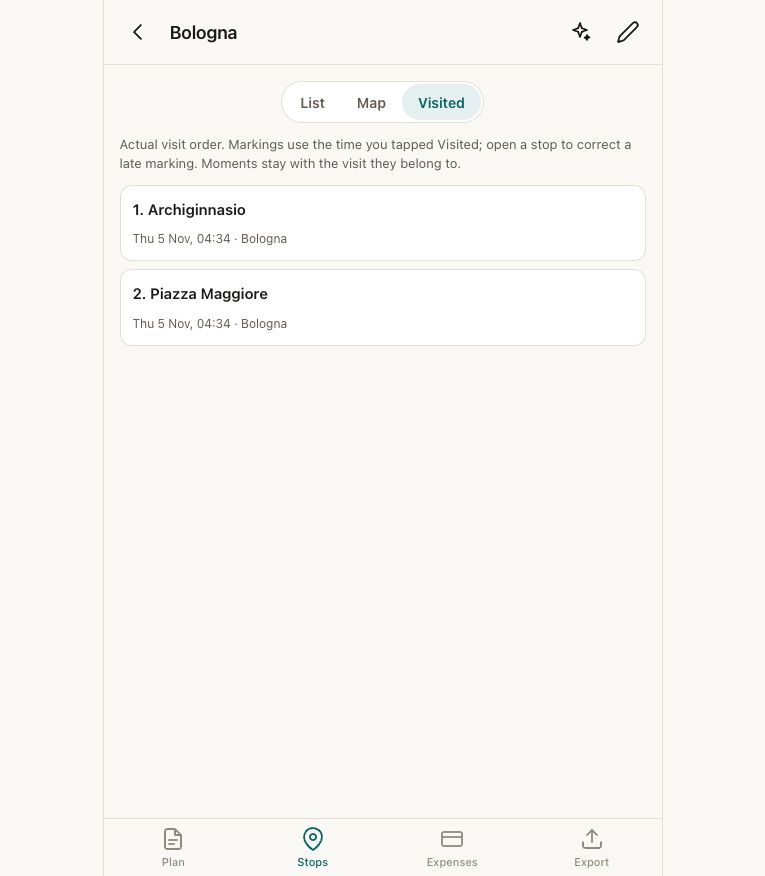
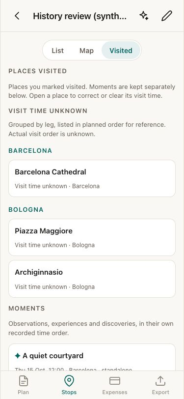
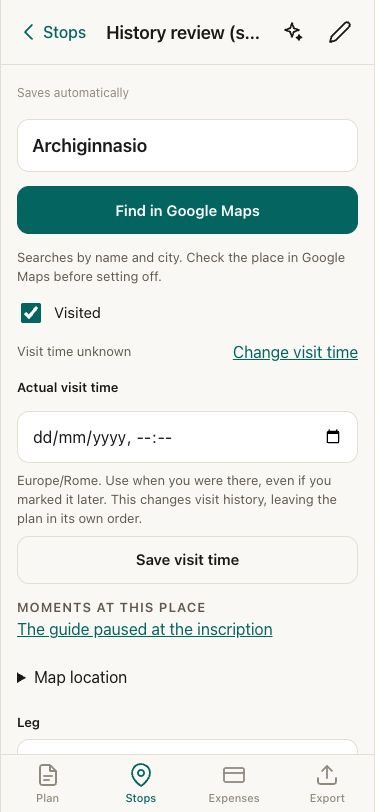
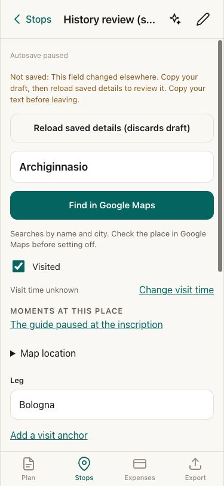

# Visited and open-editor review, 5 November 2026

Base: `c30f0e0`, the current main at review start. Synthetic data only.

## Decision and evidence

The job is to retrieve the places actually visited without maintaining a second
numbered list in Google Maps. Moments also hold observations, events and quickly
visited discoveries. A timestamp on one does not identify when its linked place
was visited, or turn a standalone observation into a place.

The old shared timeline sorted standalone Moments before all untimed historical
places, including across legs. It also numbered Moments and untimed places in the
export, and described that sequence as actual visit order. This was confirmed in
code and reproduced in regression fixtures, not inferred from the screenshot.

Keep the existing Stop and Moment records. Visited now puts places first:
recorded times in their own order, then untimed places grouped by leg in planned
order explicitly labelled as reference only. Moments keep their own recorded time
order, notes, photos and links. Linked memories are also accessible inside their
place. Nothing classifies old Moments automatically or borrows their timestamps.
A discovered site can remain a Moment; no second place-history system is added.

New markings on past or completed trips stay untimed. Existing times are retained,
including potentially late markings; the traveller can correct or clear them.
Planned order is unchanged. One shared place-history function feeds Visited and
both journal prompts. Exports identify planned stops separately and tell the
journal writer to ask about missing chronology rather than invent it. The
reconstruction prompt also includes any existing Moments.

## Flow checks

1. **Existing Visited: misleading chronology claim.** The screenshot shows the
   old wording on a synthetic one-city trip. The multi-city/untimed defect above
   was confirmed separately in code and tests.
   
2. **Historical Visited: passes.** At 375px, Barcelona and Bologna places are
   legible, untimed and unnumbered; Moments follow separately. A long trip title
   exposed a grid-width issue, corrected with a single column constraint.
   
3. **Place detail: passes.** The correction labels its time zone and linked
   memories remain reachable. The existing visit-time field can be cleared
   without unmarking the visit. Keyboard navigation and return focus are covered
   by browser tests.
   
4. **Concurrent editor: passes.** A second local editor changed the saved note;
   the first editor's stale autosave was refused. Its draft remained available,
   with an alert, paused indicator and explicit reload action. The browser suite
   also exercises actual NAS sync while the editor stays open, rapid typing,
   pin removal and recovery. The comparison happens inside the database write,
   so it does not depend on live-query refresh timing. Only the edited fields
   are compared. No persistent conflict workflow is added.
   

## Validation and limits

- 344 unit tests; 468 browser tests across desktop Chromium, mobile Chromium and
  iPhone WebKit, including current, previous and original local PHP receivers.
- One production service-worker update test. Formatting, lint, Svelte/TypeScript
  checks, PHP syntax and production build pass.
- ZIP restore, old snapshot validation/merge, deletion and offline navigation
  remain covered. No schema, migration, backup or sync-format changes.
- Three opt-in live-NAS tests are skipped. No production data or NAS was touched.
- No real iPhone or screen-reader session. Screenshots do not establish full
  accessibility compliance. No user study validates the chosen presentation.
- Historical actual order remains unknown where it was never recorded. Existing
  timestamps cannot distinguish a contemporaneous visit from a late marking;
  this change preserves them and offers correction rather than guessing.
